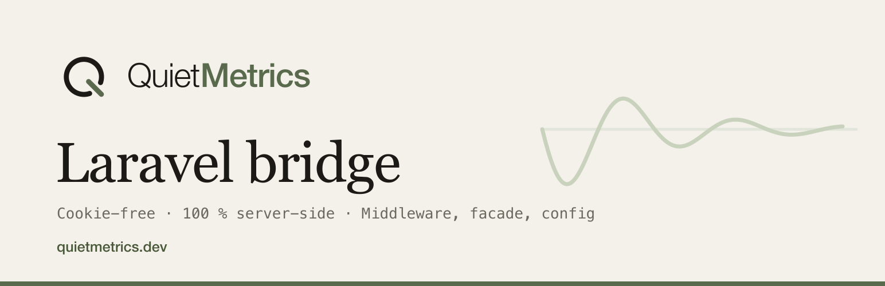

# quiet-metrics/laravel-metrics



> 🇫🇷 [Version française](README.fr.md)

Laravel bridge for [Quiet Metrics](https://quietmetrics.dev) (La Boîte à Code): automatic server-side pageviews via middleware, a facade for events, publishable configuration. Tracking is 100% server-side and JS-free, with no identification or tracking cookies, invisible to ad blockers. Built on the [core PHP package](https://github.com/Quiet-Metrics/php-metrics) (`quiet-metrics/php-metrics`).

Compatible with Laravel 10 to 13 (illuminate/support ^10 || ^11 || ^12 || ^13), PHP >= 8.1.

## Installation

```bash
composer require quiet-metrics/laravel-metrics
```

The service provider and the facade alias are registered automatically (package discovery).

## Upgrading

Each 0.x minor version of the bridge requires the matching minor version of the core SDK `quiet-metrics/php-metrics`: upgrade both together, and only those two.

```bash
composer require quiet-metrics/laravel-metrics:^0.5 --no-update
composer update quiet-metrics/laravel-metrics quiet-metrics/php-metrics
```

A plain `composer require` fails, because the core SDK is locked in `composer.lock`. Composer's error message then suggests `-W`: that option updates every dependency of the project, Laravel included. Read the [CHANGELOG](CHANGELOG.md) before upgrading: it flags changes in what gets counted.

## Configuration

Publish the configuration file (optional; environment variables are enough in most cases):

```bash
php artisan vendor:publish --tag=quiet-metrics-config
```

Environment variables:

```dotenv
# Site keys, from the "Installation" panel of the Quiet Metrics dashboard.
QUIET_METRICS_PUBLIC_KEY=qm_pub_xxxx
# ESSENTIAL for server-side sending: enables signed mode (HMAC), the only
# case where the visitor IP/UA carried by your server are trusted. Without
# it, every hit would carry your server's IP: a single visitor counted.
QUIET_METRICS_SECRET_KEY=qm_sec_xxxx

# Optional:
QUIET_METRICS_ENDPOINT=https://quietmetrics.dev/api/v1/collect
QUIET_METRICS_TRUST_PROXY=false   # true if the app sits behind a reverse proxy / CDN
```

## Usage

### Middleware: automatic pageviews

The middleware is registered under the `quiet-metrics` alias. Per route or per group:

```php
Route::middleware('quiet-metrics')->group(function () {
    // ... your web routes
});
```

Globally on the whole web group, Laravel 11+ (`bootstrap/app.php`):

```php
use QuietMetrics\Laravel\Middleware\TrackPageview;

->withMiddleware(function (Middleware $middleware) {
    $middleware->web(append: TrackPageview::class);
})
```

Laravel 10 (`app/Http/Kernel.php`):

```php
protected $middlewareGroups = [
    'web' => [
        // ...
        \QuietMetrics\Laravel\Middleware\TrackPageview::class,
    ],
];
```

Automatic pageviews are HTML/XHTML documents rendered in response to a `GET`, including 404/500 errors raised by one of your application's routes (`abort(404)`, model not found). Redirects, empty responses (204/205), PDFs, JSON and attachments are excluded, along with AJAX, announced prefetches and opted-out visitors.

**Addresses that match no route are not measured** by the `web` group integration: when no route matches, Laravel runs no group middleware. These 404s include broken links and old addresses, but also most requests from bots probing websites (`/wp-login.php`, `/.env`). To measure them anyway, register the middleware in the global stack, **instead of** the `web` group: `$middleware->append(TrackPageview::class)` on Laravel 11+, the `$middleware` array of `app/Http/Kernel.php` on Laravel 10. The global stack also covers routes outside the `web` group, such as an admin panel: leave them out with the excluded paths in the site settings. Do not register the middleware in both places, or every page would be counted twice.

From version **0.4.0**, `'track_404' => true` also emits a `404` event with the page path, on the 404s the middleware sees and no others. This option is off by default: each additional event consumes quota. Enable it server-side or through the script’s `data-404` on a given page to avoid duplicate events. Server tracking cannot see pages served by a cache that bypasses PHP.

### Facade: custom events

```php
use QuietMetrics\Laravel\Facades\QuietMetrics;

// Event with properties (scalar values, 30 keys max).
QuietMetrics::event('signup', ['plan' => 'pro']);

// Manual pageview, overridable context (useful outside HTTP requests:
// jobs, artisan commands; `url` is then required).
QuietMetrics::pageview(['url' => 'https://mysite.com/pricing']);
```

You can also inject `QuietMetrics\Tracker` (the interface the `Client` singleton implements) instead of going through the facade: type-hinting the interface is what makes your code replaceable in tests.

### In your tests

From version 0.5.0, `QuietMetrics::fake()` replaces the client with a fake that records instead of sending. The middleware's pageviews go through it too.

```php
use QuietMetrics\Laravel\Facades\QuietMetrics;

QuietMetrics::fake();

$this->post('/register', [...])->assertRedirect();

QuietMetrics::assertEventSent('signup', ['plan' => 'pro']);
QuietMetrics::assertPageviewSent();
```

Other assertions: `assertEventNotSent('name')` and `assertNothingSent()`. The fake records what your application asks for, before the minimization applied when sending.

## Opting out of measurement

A visitor can ask to stop being counted, with no account and without writing to anyone: they visit a page of your site with `?qm_ignore=1`, and `?qm_ignore=0` puts them back into measurement.

```
https://mysite.com/?qm_ignore=1     stop being counted
https://mysite.com/?qm_ignore=0     be counted again
```

The marker is a **first-party cookie of your own site**, named `qm_ignore` with the value `1` (`path=/`, `samesite=lax`, `secure` over https, five years). A dedicated `HandleOptOut` middleware takes care of it, registered globally by the service provider: the marker can therefore be set from **any URL**, not only from the routes you track. Nothing to wire. To handle it yourself, set `quiet-metrics.register_opt_out_middleware` to `false`; the `quiet-metrics-optout` alias stays available.

It holds no identifier (its value is the same for everyone), it is never transmitted to Quiet Metrics, and it exists only to stop measurement: it is an opt-out marker, not a tracker. The JS tracker additionally writes the same value to `localStorage`, but a server-side SDK only ever reads the cookie: one visit therefore covers both tracking modes.

## Visit continuity

When the visitor fingerprint changes mid-visit (4G, then wifi), the same person would otherwise be counted as two unique visitors on the same day. A second **first-party cookie of your own site** closes that gap: `qm_visit`, value `1` (`path=/`, `samesite=lax`, `secure` over https), on a sliding ten-minute window pushed back by every measured hit. Each hit reports whether it was already there as the `c` key of the payload.

Its value is a constant, the same for everyone, so it identifies nobody: it only says that a visit is already under way in this browser. It is never written to someone who has set the opt-out marker, and never written when nothing is measured: the `quiet-metrics` middleware writes it during the response phase, on the very requests whose pageview it sends in `terminate()`. Like the opt-out marker, it is exempt from Laravel cookie encryption, since the JS tracker of the same site has to read the same window.

Note for cached sites: a measured response now carries a `Set-Cookie` header, which some reverse proxies and CDNs treat as a reason not to store the response.

## How it works

The provider builds a `Client` singleton (core package) from the `quiet-metrics` config. The middleware sends the pageview in `terminate()`, after the response has been sent to the visitor: no impact on perceived latency. The context (URL, referrer, IP, User-Agent, language) comes from the `Request` object, never from superglobals: correct under Octane and persistent workers, in tests, and aligned with the host application's trusted proxies. On the core side, only what the platform reads is sent (the page address reduced to its origin, its path and the `utm_source`, `utm_medium`, `utm_campaign` and `ref` parameters; the referrer reduced to its origin), sending is non-blocking (fire-and-forget socket, short cURL fallback) and every failure is silent: analytics never breaks the site.

## Tests

```bash
composer update && composer test
```

Orchestra Testbench suite against the core package's HTTP capture server: signed middleware pageview (HMAC verified), exclusions (JSON, PDF, POST, redirects), `event` facade, configured singleton.

## License

MIT. A [La Boîte à Code](https://laboiteacode.fr) product for [Quiet Metrics](https://quietmetrics.dev).
